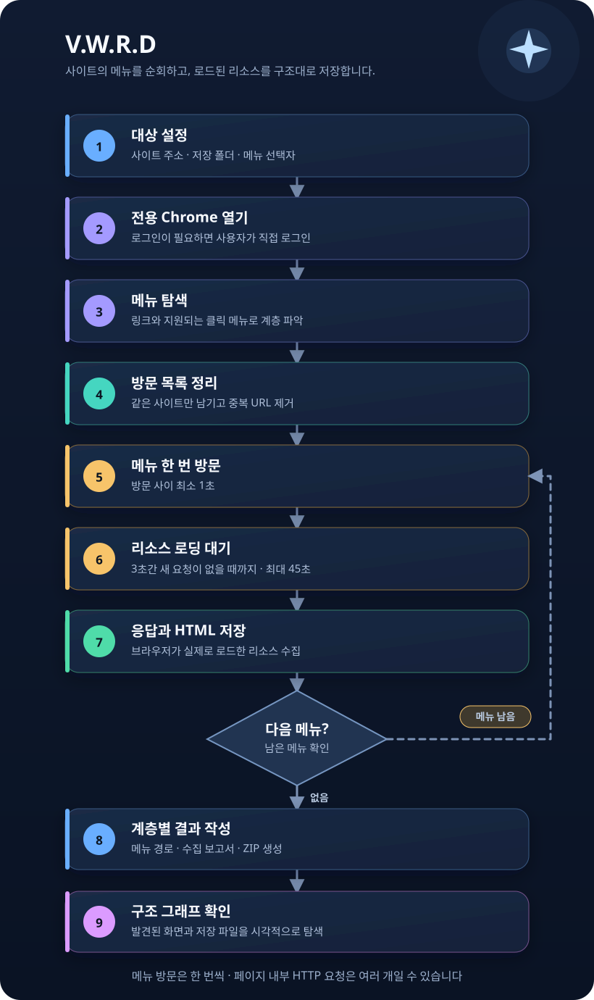

# V.W.R.D

Windows용 사이트 리소스 수집 앱입니다. 사용자가 사이트 주소를 입력하면 전용 Chrome 창에서 같은 출처의 메뉴를 찾아 한 번씩 방문하고, 브라우저에 로드된 응답 본문과 각 페이지의 최종 HTML을 저장합니다. 로컬 MCP stdio 서버도 제공합니다.

앱 로고는 웹사이트 위에 별이 떠 있는 심볼입니다. 화면과 Windows 실행 파일에 같은 로고를 사용하며, 원본 SVG와 PNG·ICO 파일은 `branding/`에 있습니다.

## 동작 흐름



메뉴 URL은 한 번씩 방문합니다. 한 페이지에서 이미지·스크립트 등을 로드할 때는 여러 HTTP 요청이 발생할 수 있습니다.

## 사용

1. [최신 릴리스](https://github.com/v3s9er/V.W.R.D/releases/latest)에서 `VWRD-Setup.exe`를 받아 설치하거나 `VWRD-Windows.zip`의 `VWRD.exe`를 바로 실행합니다. Chrome과 Microsoft WebView2 Runtime이 설치되어 있어야 합니다.
2. 사이트 주소와 저장 폴더를 입력합니다. 자동 탐색이 메뉴를 놓치면 메뉴 영역의 CSS 선택자(예: `nav.sidebar`)를 입력합니다.
3. 로그인이 필요하면 **Chrome 열기**를 누르고 열린 창에서 로그인합니다. 이 앱은 `%LOCALAPPDATA%\SaveAllResourcesGo\ChromeProfile` 전용 프로필을 사용합니다.
4. **수집 시작**을 누릅니다. 완료 후 **구조 보기**에서 발견한 메뉴를 가로로 펼친 계층 그래프와 메뉴별 파일로 확인합니다. 그래프는 휠이나 `+`·`−` 버튼으로 확대·축소하고, 빈 공간을 드래그해 이동하며, **전체 보기**로 화면에 맞출 수 있습니다. **폴더 열기**에서 결과 파일을 확인할 수 있습니다.

설치판은 GUI, MCP 실행 파일, 로고를 함께 설치합니다. 현재 사용자용으로 설치되며 시작 메뉴 바로가기를 만들고, 바탕화면 바로가기는 선택 사항입니다. Windows **설치된 앱**에서 제거할 수 있습니다. Chrome과 WebView2는 별도 설치가 필요합니다.

업데이트할 때 V.W.R.D 앱과 MCP 서버가 실행 중이면 먼저 종료하세요. 설치 프로그램이 실행 파일 잠금을 감지하면 파일을 일부만 바꾸지 않고 중단하며, 종료 후 **다시 시도**할 수 있습니다.

이전에 분석한 구조를 보려면 **분석 폴더 불러오기**에서 `capture-...` 폴더 또는 그 상위 저장 폴더를 선택하세요. 상위 폴더를 선택하면 가장 최근 수집 보고서를 엽니다. **세부 설정**에서 메뉴 선택자와 대기 시간을 조절할 수 있습니다. 기본 방문 상한은 메뉴 1,000개입니다.

기본 메뉴 방문 간격은 1,000ms이며, 더 작은 값이 입력되어도 1,000ms로 올립니다. 페이지마다 네트워크 요청이 모두 끝나고 3,000ms 동안 새 요청이 없으면 다음 메뉴로 이동합니다. 최대 대기는 기본 45,000ms이며 화면에서 조절할 수 있습니다. 장시간 연결이 열린 사이트는 최대 대기 시간에 도달하면 해당 페이지를 `timeout`으로 기록하고 다음으로 진행합니다.

## 결과

각 작업은 저장 폴더에 `capture-날짜시각` 디렉터리와 같은 이름의 ZIP 파일로 생성됩니다.

```text
capture-.../
  site/<호스트>/<원래 URL 경로>       브라우저 응답 및 최종 HTML
  menus/<사이트 메뉴 계층>/page.json  방문 메뉴와 리소스 목록
  capture-report.json                전체 메뉴 구조와 방문 보고서
```

같은 메뉴 URL은 쿼리 매개변수 순서와 일반 앵커 조각을 정규화해 중복 방문하지 않습니다. 해시 라우트(`#/...`)는 별도 메뉴로 처리합니다. 같은 URL과 같은 내용의 리소스는 한 파일만 저장합니다. 같은 URL의 내용이 바뀌면 `__v...` 접미사가 붙은 별도 파일을 저장합니다. Chrome이 사이트 자체 스크립트로 발생시키는 HTTP 요청까지 차단하지는 않습니다.

## MCP

설치판은 앱과 `VWRD-MCP.exe`를 같은 폴더에 설치합니다. 설치하지 않은 경우 `VWRD-release/VWRD-MCP.exe --mcp`를 사용할 수 있습니다. 클라이언트에 **stdio MCP 서버**로 등록할 때 실행 파일의 절대 경로와 인수 `--mcp`를 지정하세요. 이 서버가 제공하는 도구는 다음과 같습니다.

| 도구 | 기능 |
| --- | --- |
| `open_browser` | 로그인할 전용 Chrome 창 열기 |
| `start_crawl` | 주소, 저장 폴더, 메뉴 선택자, 대기 시간을 받아 수집 시작 |
| `get_status` | 진행 상태 확인 |
| `stop_crawl` | 진행 중인 수집 중지 |
| `get_report` | 현재 또는 저장된 수집의 메뉴별 결과 확인 (`output_dir` 선택 입력) |

`start_crawl` 예시 인수:

```json
{
  "url": "https://example.com/",
  "output_dir": "C:\\Users\\me\\Documents\\SiteCapture",
  "menu_selector": "nav",
  "min_delay_ms": 1000,
  "idle_ms": 3000,
  "max_wait_ms": 45000,
  "max_menus": 1000
}
```

## 적용 범위

메뉴는 `nav`, 사이드바, `menu`/`nav` 계열 요소 안의 링크와 URL 속성에서 탐색합니다. `www.iprovest.com`의 `usrBody(...)`·`maingo(...)` 메뉴는 콜백의 정적 경로를 읽어 해당 화면의 GET 주소로 방문합니다. 콜백 자체나 거래 제출 동작은 실행하지 않습니다. 다른 클릭 전용 JavaScript 메뉴, 스크롤해야만 나타나는 메뉴, 서비스 워커 내부 데이터, 무한 로딩 콘텐츠는 사이트마다 추가 규칙이 필요할 수 있습니다. 브라우저가 실제로 요청하지 않은 리소스는 수집할 수 없습니다.

## 소스 빌드

Go 1.27 이상과 Windows가 필요합니다. 화면은 Wails의 WebView2를 사용하며, `cmd/sar/rsrc.syso`에 Windows 매니페스트와 앱 아이콘이 포함되어 있습니다. 로고를 수정했다면 먼저 `scripts/build-icon.ps1`을 실행하세요.

```powershell
go test ./...
./scripts/build-icon.ps1
go build -trimpath -tags desktop,production -ldflags='-H windowsgui -s -w' -o VWRD-release/VWRD.exe ./cmd/sar
go build -trimpath -ldflags='-s -w' -o VWRD-release/VWRD-MCP.exe ./cmd/sar
./scripts/build-installer.ps1  # NSIS 3.13 필요
```

## 라이선스

[MIT](LICENSE)
